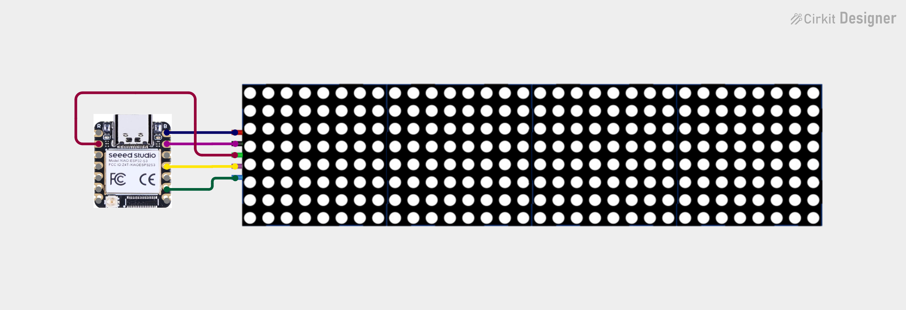

# XiaoMatrixClock

Open-source NTP-synced digital clock using a XIAO ESP32-S3 (non-camera variant) and 4x cascaded MAX7219 8x8 LED matrices, built in MicroPython. Displays time in HH:MM format using a custom 5x7 pixel font, with a blinking colon.

## Features

- WiFi connect + NTP time sync (with fallback across multiple NTP servers)
- Custom 5x7 bitmap font for digits 0-9
- Blinking colon separator
- IST (UTC+5:30) timezone handling
- Runs on SoftSPI (safe for any free GPIO pins)

## Hardware

- Seeed XIAO ESP32-S3 (non-camera)
- 4x MAX7219 8x8 LED dot matrix module (cascaded)
- Jumper wires

## Wiring

| MAX7219 Pin | XIAO Pin | GPIO |
|---|---|---|
| DIN | D10 | GPIO9 |
| CLK | D8  | GPIO7 |
| CS  | D1  | GPIO2 |
| VCC | 5V  | - |
| GND | GND | - |

> Note: D3 (GPIO4) was found non-functional on the test board; CS was moved to D1 (GPIO2) instead.

## Setup

1. Flash MicroPython firmware onto the XIAO ESP32-S3.
2. Copy `max7219.py` driver and `main.py` onto the board.
3. Edit the `SSID` and `PASSWORD` fields in `main.py` with your WiFi credentials.
4. Reset the board. It will connect to WiFi, sync time via NTP, and start displaying the clock.

## Dependencies

- [`max7219.py`](https://github.com/mcauser/micropython-max7219) MicroPython driver

## License

MIT